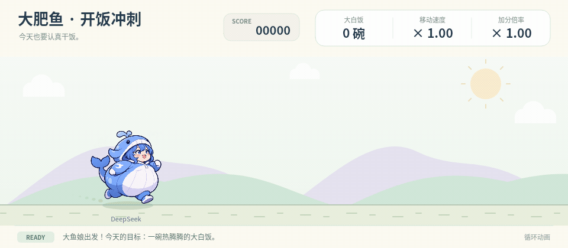

<h1 align="center">🐟 大鱼娘 · 开饭冲刺</h1>

<p align="center"><samp>龙娘在天上，猫娘在地上。饭在碗里，我在路上。</samp></p>

<p align="center">
  
</p>

<p align="center">
  🐟 DeepSeek 大鱼娘 &nbsp; · &nbsp; 🐉 ChatGPT 龙娘 &nbsp; · &nbsp; 🐈 Gemini 猫娘
</p>

<p align="center"><strong>🍚 每碗大白饭：移动速度 +5% · 得分 +5%</strong></p>

---

<details>
<summary>🍚 再给大鱼娘盛一碗</summary>

```text
[ OK ] 白饭已签收
[ OK ] 累计干饭：2 碗
[BUFF] 移动速度：×1.10
[BUFF] 得分倍率：×1.10
```

**大鱼娘：谢谢，八分饱了。剩下九十二分等会儿吃。**

<details>
<summary>那再来一碗，真的是最后一碗了</summary>

```text
[ OK ] 累计干饭：3 碗
[BUFF] 移动速度：×1.15
[BUFF] 得分倍率：×1.15
[WARN] “最后一碗”的可信度已归零
```

**大鱼娘：你负责盛，我负责相信。**

</details>

</details>

<details>
<summary>👂 偷听龙娘和猫娘聊天</summary>

🐉 **ChatGPT 龙娘：** 我可以从三个方面解释，为什么她越吃跑得越快。

🐈 **Gemini 猫娘：** 别解释了，她已经把你的那碗也吃了。

🐟 **DeepSeek 大鱼娘：** 思考中……再来一碗。

</details>

<details>
<summary>🔴 这个按钮真的不能点</summary>

### 🏆 隐藏成就：逆向听劝大师

你成功证明了：“不要点”是最好用的按钮文案。

🐟 **大鱼娘：** 来都来了，帮我把锅端过来。

</details>

---

<p align="center"><sub>跑酷是循环的，干饭是认真的。</sub></p>
